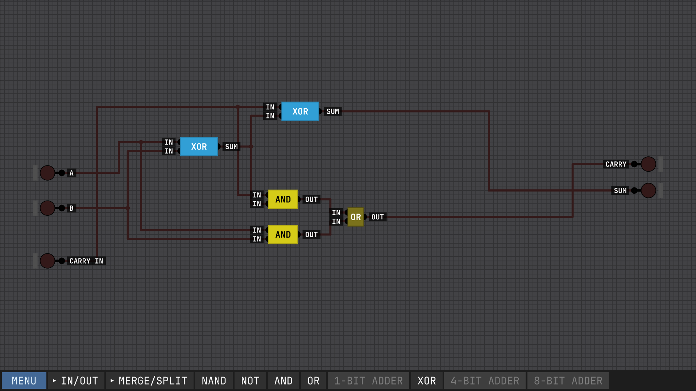
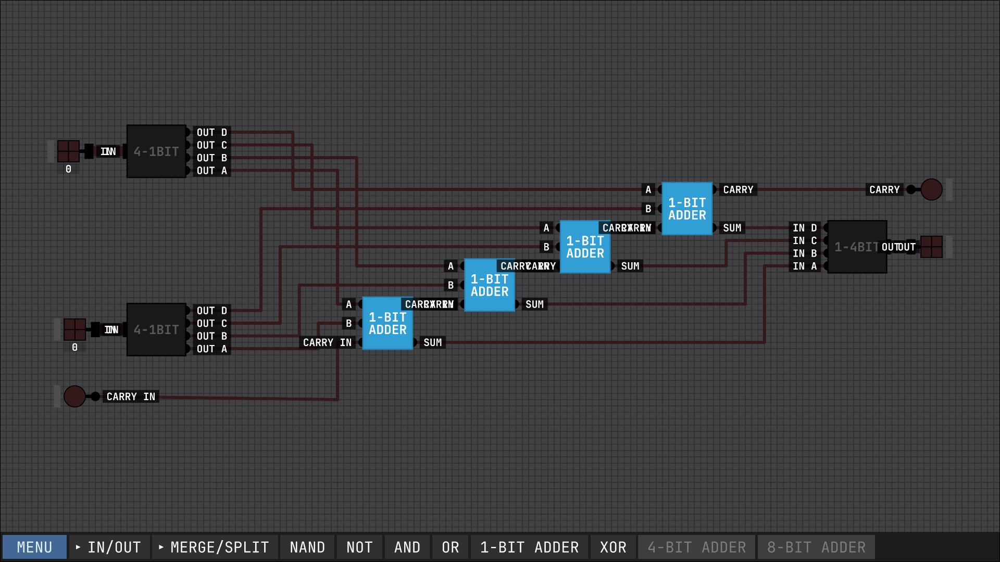
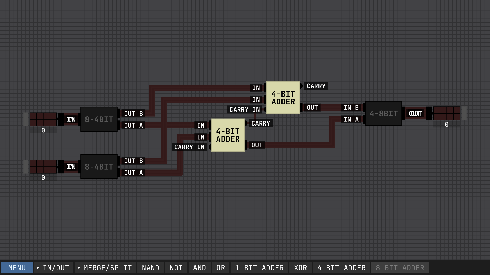
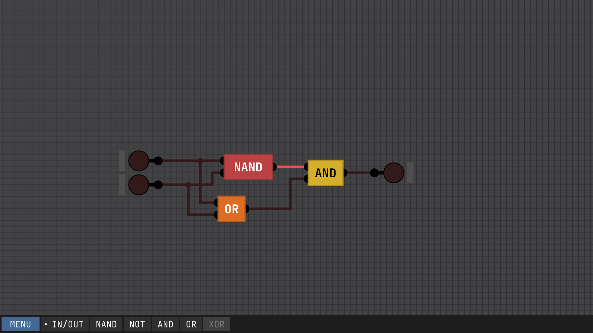
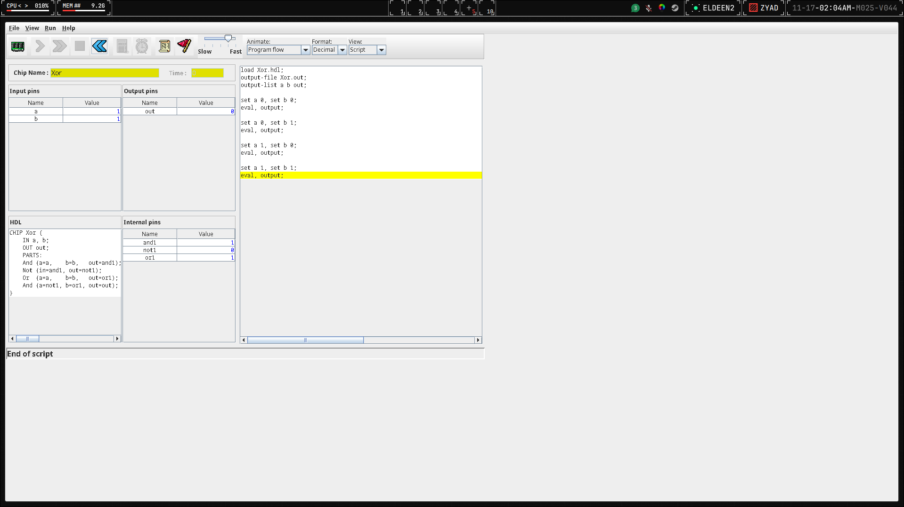
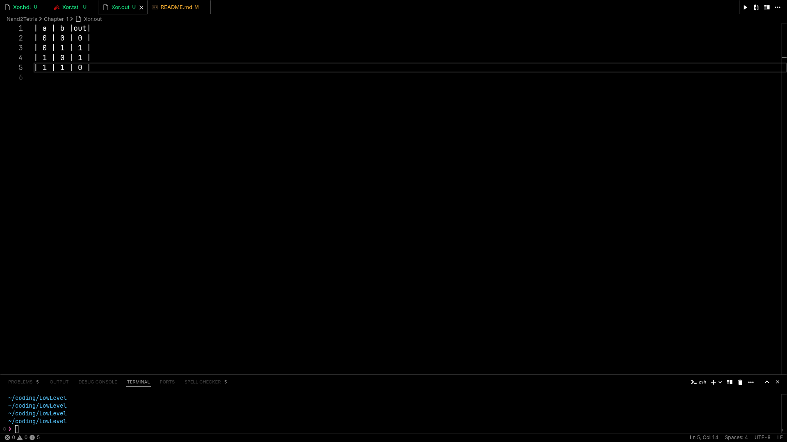

# This will be the a log of my reading of Nand2tetris book and projects made in Sebastian Lague Digital Logic sim will be referenced as DLS

## 23-10-2026
### At page 10
In the previous days independently of the book and by watching Sebastian Lague videos i made a one bit and 4-bit and 8-bit 
adder 

Those were made by taking each question in the video as a question to solve not following the video to make the chips

## 24-10-2026
### At page 12
Couldn't read a lot today because I had to study two lecture in electrical materials 

## 25-10-2026
### At page 19
Stopped when they started talking into boolean algebra because right now my brain is fried, and need to recheck on how nand gates to made and work in real life to link computers and real life implementation together

## 28-10-2026 
### At page 21
### Appendix 1 at 290
### To be done
1. Need to touch upon what is a boolean function and what is a boolean expression, hopefully after Appendix 1 I will understand better
2. Memorize a little bit the boolean functions at Figure 1.2

## 12-11-2026
### At page 21
### Appendix 1 Done to A1.2
Been a cumbersome 2 weeks of midterms, but logical circuits design had sop and pos in it, so if fast forwarded appendix 1 part 2 without too much complication

## 13-11-2026
### At page 23
### Appendix 1 Done to A1.2
Wanted to implement Xor first to continue reading but on a trip, so I couldn't get on a computer 

## 14-11-2026
### At page 24
### Appendix 1 Done to A1.2

Just played around with DLS and re implemented basic Logic gates NOT, AND, OR and XOR

## 16-11-2026
### At page 27
### Appendix 1 Done to A1.2

Understood Xor gate wrong last time, so I reimplemented it and tried writing .hdl, .tst and using first application of the software suite

## 17-11-2026
### At page 37
### Appendix 1 Done to A1.2
### To be done
1. Most of project 1 in hdl and in DLS 

